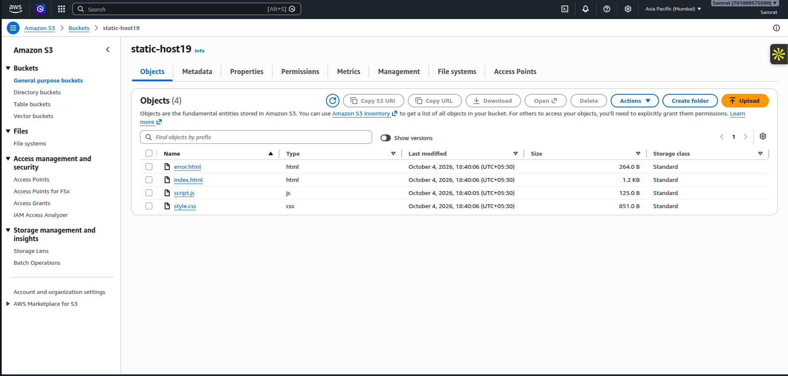
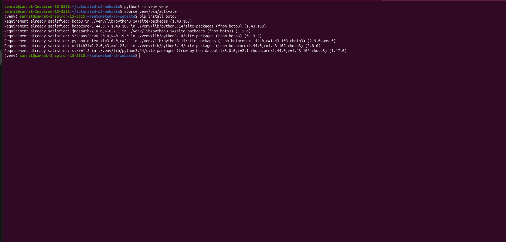
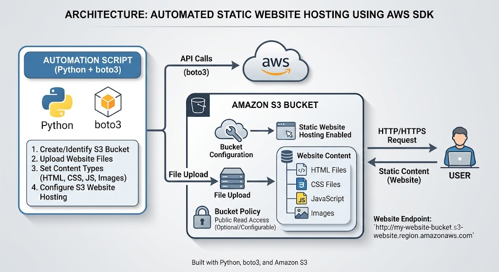

# CloudCanvas

A lightweight static website deployment project that provisions an Amazon S3 bucket, enables static website hosting, applies a public read policy, uploads the website files, and prints the public URL for the published site.

This project is designed for simple landing pages and single-page sites that do not require a backend. It uses Python and the AWS SDK for Python (Boto3) to automate the deployment process.

## What this project does

- Creates or reuses an S3 bucket configured for website hosting
- Disables the public access block so the site can be served publicly
- Configures the S3 static website index and error documents
- Adds a bucket policy that allows anonymous read access to objects
- Uploads the contents of the `website/` folder with the correct content types
- Prints the generated website URL after deployment

## Project structure

```text
.
├── deploy.py             # Automated deployment script
├── requirements.txt      # Python dependencies
├── website/
│   ├── index.html        # Main landing page
│   ├── style.css         # Styling for the site
│   ├── script.js         # Small JavaScript helper logic
│   └── error.html        # Error page shown by S3 hosting
└── README.md             # Project documentation
```

## Services
- Amazon S3
- Boto 3





## Architecture



## Result


## Prerequisites

Before you run the deployment script, make sure you have:

- Python 3.9+
- An AWS account with permissions to create and configure S3 buckets
- AWS credentials configured locally via AWS CLI or environment variables
- The `boto3` package installed

## Setup

1. Clone or download the project.
2. Open a terminal in the project root.
3. Create and activate a virtual environment if desired:

```bash
python -m venv .venv
source .venv/bin/activate
```

4. Install dependencies:

```bash
pip install -r requirements.txt
```

5. Configure AWS credentials:

```bash
aws configure
```

Or set the following environment variables before running the script:

```bash
export AWS_ACCESS_KEY_ID=your-access-key
export AWS_SECRET_ACCESS_KEY=your-secret-key
export AWS_DEFAULT_REGION=ap-south-1
```

## Deployment configuration

The script contains a few defaults at the top of `deploy.py` that you may need to customize:

```python
REGION = "ap-south-1"
BUCKET_NAME = "static-host19"
WEBSITE_FOLDER = "website"
INDEX_DOCUMENT = "index.html"
ERROR_DOCUMENT = "error.html"
```

Update these values to match your AWS region, desired bucket name, and project structure.

Important:

- Bucket names must be globally unique across AWS.
- The bucket name should be changed if `static-host19` is already taken.
- Static website hosting in S3 is configured per bucket.

## Deploy the website

From the project root, run:

```bash
python deploy.py
```

The script will:

1. Check whether the bucket exists.
2. Create it if needed.
3. Configure public access.
4. Enable static website hosting.
5. Add the public read bucket policy.
6. Upload all files from `website/`.
7. Print the final website URL.

Example output:

```text
Starting S3 website deployment...
Bucket already exists: static-host19
Configuring public access settings...
Configuring static website hosting...
Creating bucket policy...
Uploading website files...
Deployment completed successfully!

Website URL:
http://static-host19.s3-website-ap-south-1.amazonaws.com
```

## Example URL format

The generated site will be available at:

```text
http://<bucket-name>.s3-website-<region>.amazonaws.com
```

## Notes

- This setup is best for static content only.
- Any changes you make in the `website/` directory can be uploaded by rerunning `python deploy.py`.
- If you want to use a different AWS region or bucket, update the configuration in `deploy.py` before deployment.

## Why this project is useful

This repository is a simple, repeatable example for hosting static sites on AWS S3 without needing a frontend framework, server, or complex infrastructure. It is ideal for demos, portfolios, documentation pages, landing pages, and small marketing websites.


Amazon S3 Static Website Hosting – Learned how to host a static website directly from an S3 bucket without a traditional web server.
Boto3 Automation – Used Python and Boto3 to automate AWS resource creation, configuration, and file uploads.
S3 Bucket Management – Learned how to create/reuse buckets and work with globally unique bucket names.
Public Access Configuration – Learned how S3 Block Public Access settings interact with bucket policies.
Bucket Policies & IAM – Implemented a public s3:GetObject bucket policy for anonymous website access.
Static Website Configuration – Configured index.html and error.html as S3 website documents.
Automated File Uploads – Uploaded website files programmatically and handled appropriate content types such as HTML, CSS, and JavaScript.
AWS CLI & Credentials – Learned how to configure AWS credentials locally using aws configure and environment variables.
Python Virtual Environments – Used a virtual environment to isolate project dependencies such as Boto3.
AWS Region Awareness – Learned that S3 website endpoints and bucket configuration depend on the selected AWS region.
Deployment Automation – Created a repeatable deployment process where website changes can be published simply by rerunning the deployment script.
Cloud Architecture Understanding – Understood a simple architecture: User → S3 Static Website → Website Files.
Troubleshooting AWS Deployments – Gained practical experience identifying issues related to bucket existence, permissions, public access, object uploads, and website endpoints.